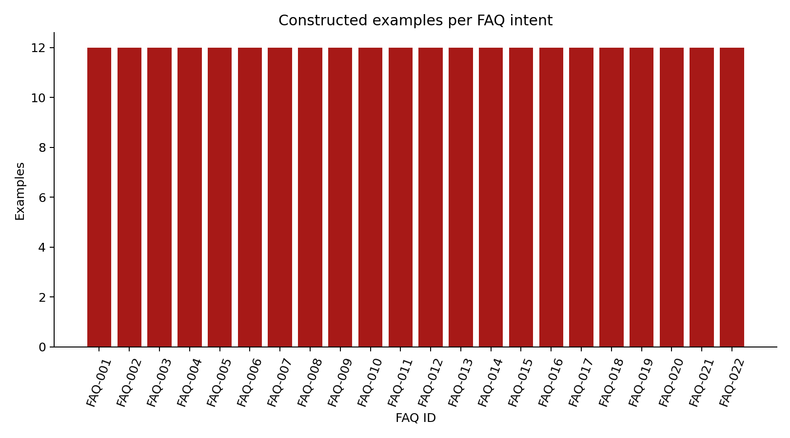
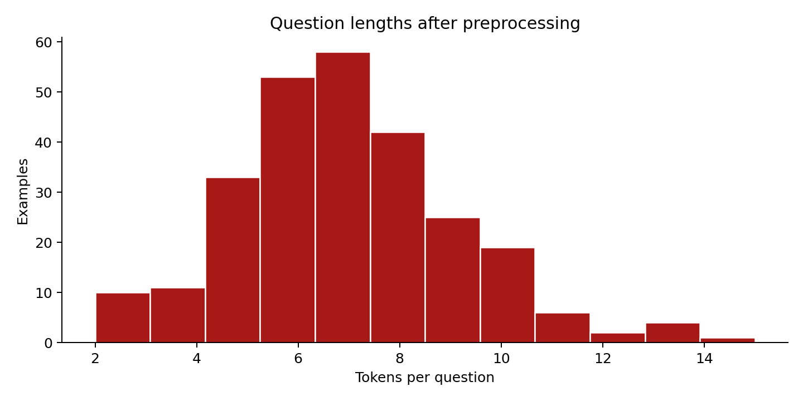
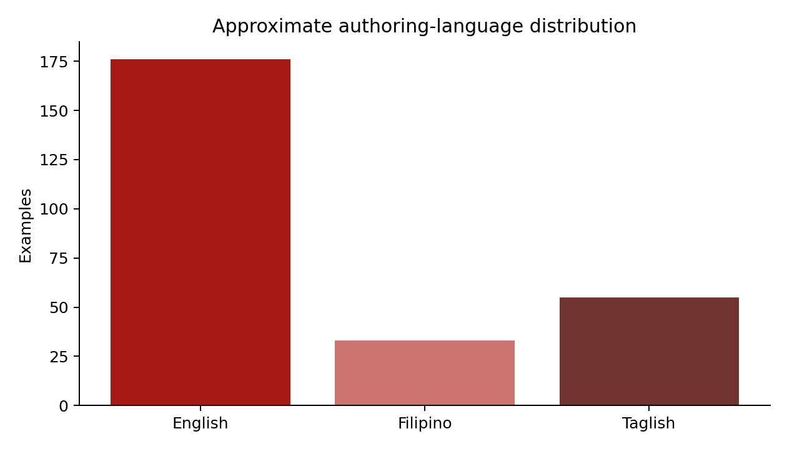
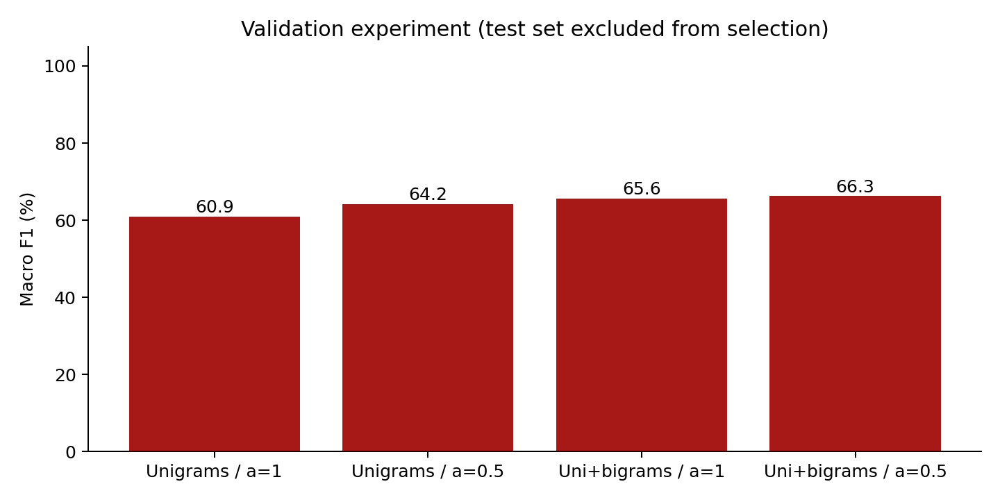
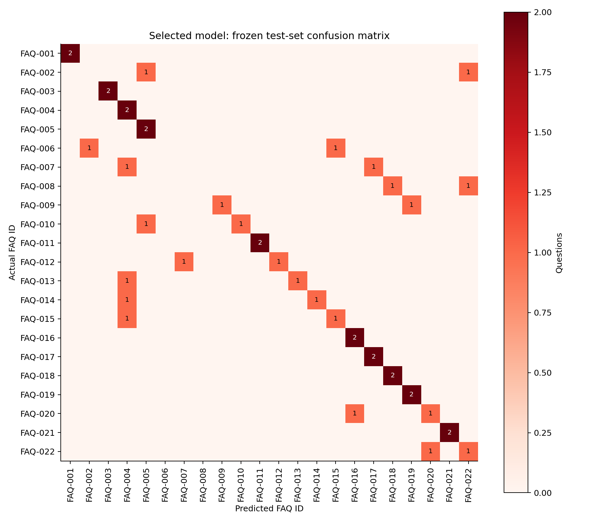

# CCIThink: Development and Evaluation of a Source-Grounded CCIT Chatbot with Naive Bayes FAQ Classification

IMRaD research manuscript

Boncajes, Rhian Jared D.

Marcos, Maricar N.

Carandang, Jamie Pearl U.

CCIT, FAITH Colleges

Principles of Artificial Intelligence and Data Science

November 2026 · Draft for author review

<!-- page break -->

## Abstract

This project developed CCIThink, a web-based department information chatbot for CCIT at FAITH Colleges, and added a reproducible data-science workflow while preserving its existing interface. The work addressed how a small, documented question dataset can support explainable FAQ classification without allowing a learned prediction to replace source evidence. Twenty-two FAQs from a supplied department document were paired with 264 AI-assisted constructed questions, allocated to 176 training, 44 validation and 44 test examples. The pipeline validated a CSV dataset, normalized text, summarized data quality, and produced five exploratory and evaluation figures. A standard-Python multinomial Naive Bayes implementation compared unigrams and unigrams plus bigrams under two smoothing settings. Validation macro F1 selected the unigram-plus-bigram model with alpha = 0.5. It correctly classified 28 of 44 test questions (63.6% accuracy), with macro F1 = 0.595; a training-majority baseline obtained 4.5% accuracy. These findings describe a controlled, constructed corpus, not real-world student accuracy. Errors, especially in some Filipino wordings and related academic intents, support using the classifier as a bounded ranking aid behind source checks. The completed prototype demonstrates dataset handling, machine learning, evaluation, visual interpretation and responsible-use documentation. Independent student-data evaluation and current department verification remain future work.

Keywords: department chatbot; FAQ classification; multinomial Naive Bayes; data analysis; responsible AI

## Introduction

### Background and problem

CCIThink addresses the practical task of locating department information in a supplied CCIT document. Its knowledge base covers programs, scholarships, faculty, facilities and related activities. A conversational interface can help users ask these questions in familiar wording, but useful behavior requires both relevant answer selection and clear boundaries around missing information. This project does not claim that staff workload, response delays or student satisfaction were measured before development. The need is framed as an information-access and classification problem rather than as a demonstrated reduction in administrative workload.

The original system used reviewed FAQ records, lexical retrieval and optional Gemini or OpenAI answer generation. That combination alone did not demonstrate all of the course's data-science requirements. The final-project handout calls for dataset management, preprocessing, at least three visualizations, an implemented algorithm, task-specific evaluation, experimentation and an ethics discussion (Final project: AI-powered data analysis and prediction system, n.d.). The authors confirmed that the CCIT chatbot topic had instructor approval. The adaptation therefore treats selection of one of 22 FAQ intents as the supervised learning task and adds an analysis workflow alongside the existing chat interface.

### Objectives and research questions

The general objective was to develop and evaluate a source-grounded department chatbot with a reproducible Python data-analysis and FAQ-classification component. Specific objectives were to document a relevant corpus, implement transparent cleaning, visualize its structure, implement a trainable classifier, compare prespecified configurations using validation data, evaluate the selected model on a separate test partition, and preserve source-support and privacy checks during application integration.

- RQ1: How accurately does the selected model classify held-out constructed questions into the 22 FAQ labels?
- RQ2: How do unigram versus unigram-plus-bigram features and smoothing alpha = 1.0 versus 0.5 affect validation performance?
- RQ3: Which observed errors and ethical constraints should limit use of the model inside the chatbot?

### Scope, limitations and significance

The project is an educational prototype for a small, fixed FAQ collection. It does not predict grades, assess individual students, provide private records, process enrollment transactions or verify current policy. Its contribution is an inspectable connection between dataset preparation, a learned text classifier and a working information interface. The study is relevant to students learning AI and Data Science because its counts, equations, errors and software behavior can be reproduced and explained. Department staff may review its information coverage, but deployment suitability and user benefit require additional evidence.

### Text classification and explainable learning

Multinomial Naive Bayes classifies text using feature counts, class priors and smoothed conditional likelihoods. Its conditional-independence assumption simplifies training and inference, while additive smoothing prevents unseen class-feature combinations from receiving zero likelihood. The scikit-learn documentation describes this formulation and distinguishes Laplace smoothing at alpha = 1 from Lidstone smoothing below 1 (Scikit-learn developers, n.d.-b). CCIThink implements the count-based calculation directly in Python rather than loading a pretrained text model. This makes its operation suitable for code explanation and a small course demonstration, but does not establish that it is the best classifier for the domain.

### Related conversational system

Rasa Open Source provides a related example of a machine-learning framework for contextual text and voice assistants (Rasa, n.d.). Its repository also identifies the legacy open-source project as being in maintenance mode. CCIThink has a narrower scope: it ranks documented FAQ records and carries only a small program context for follow-ups, rather than implementing a general dialogue-management framework or transactional workflow. Rasa is discussed as a related system; it was not installed, evaluated or used as an experimental baseline in this project.

### Evaluation concepts and identified opportunity

Accuracy gives the proportion of correct predictions, while per-class precision and recall describe different error types. Macro F1 averages the class-specific F1 scores and gives equal weight to every FAQ intent (Scikit-learn developers, n.d.-a). Reporting only a single overall percentage can hide classes that fail completely. A confusion matrix and language-tag breakdown therefore accompany the aggregate metrics. Naive Bayes score normalization also does not make scores reliable probabilities of correctness (Scikit-learn developers, n.d.-b). The opportunity addressed here is to expose these limitations while retaining source checks, instead of presenting a prebuilt language-model response as sufficient evidence of machine learning performance.

## Methods

### Design and data source

A developmental, computational study was conducted through software implementation and controlled offline evaluation. The unit of analysis was a question, not a student. No participants were recruited and no survey, interview, private transcript or usability outcome was collected. The supplied About CCIT document provided 22 FAQ answers and their corresponding labels (About CCIT, n.d.). Source transcription was checked during earlier development; institutional accuracy and currency were not independently confirmed. The source contains a college-name wording discrepancy that remains recorded in backend metadata.

The question corpus was constructed with AI assistance from those 22 FAQ intents. Each intent has 12 examples, fixed in authoring order before the first classifier experiment: eight training, two validation and two test examples. The resulting CSV contains 264 rows and six fields: sample_id, question, faq_id, split, language and provenance. The last two describe origin and approximate authoring language; neither enters the feature vector. Examples are not observed student demand, independently annotated language samples or an independently validated gold standard. Their size is sufficient to demonstrate the course workflow and expose errors across all 22 classes, but insufficient for population-level accuracy claims.

Table 1. Dataset allocation
| Partition | Questions per FAQ | Total questions |
| --- | --- | --- |
| Training | 8 | 176 |
| Validation | 2 | 44 |
| Test | 2 | 44 |
| Total | 12 | 264 |

### Collection and preprocessing procedures

The authoring examples are retained in question_examples.json and materialized as question_dataset.csv. A reproducible loader checks required columns, nonempty values, known FAQ IDs, allowed split and language values, unique sample IDs and a 1,000-character input limit. Missing or invalid rows and duplicates within the same split are removed and counted. Conflicting labels or an identical token sequence across different splits stop the run, because silently retaining such rows could contaminate evaluation. Exact overlap with the prior 95-question development set was checked for validation and test examples; none was found. Related wording and parallel templates may still appear across partitions, which limits independence.

Text is Unicode NFKC-normalized, case-folded, whitespace-normalized and standardized for curly apostrophes. A regular expression creates lowercase Latin-letter and number tokens, including internal apostrophes. Program abbreviations, numbers, question words and negations are retained; no stemming or stopword deletion is applied. Text is not imputed when absent. FAQ IDs are categorical targets; no one-hot encoding of language or provenance is needed because those fields are excluded. Token-length outliers are reported using the upper 1.5-IQR fence and retained when valid. An unusual question length is not itself evidence of an invalid public inquiry.

### Features, algorithm and system workflow

The training vocabulary contains only features observed in the training partition. Candidate representations are unigram counts and unigram-plus-adjacent-bigram counts. For class c and question q, the implemented decision score is: score(c, q) = log P(c) + sum over t of x_t times log[(N_ct + alpha) / (N_c + alpha times |V|)]. Here x_t is the question feature count, N_ct is its training count in class c, N_c is the total feature count in that class, and |V| is the training-vocabulary size. Class priors come from training example frequencies. Scores are normalized using a numerically stable exponential calculation; they are described as uncalibrated relative scores. Inputs with no known features yield no prediction.

Naive Bayes was selected for its transparent count-based implementation, low computational cost and suitability for a small text-classification demonstration, rather than a claim of optimality. JSON stores the trained counts and metadata without executable pickle objects. A knowledge fingerprint invalidates a model when source questions or answers change. The workflow is CSV loading, validation and normalization, descriptive analysis, training, validation-based selection, selected-model testing, figure/report export and application integration. All numerical analysis can run locally without an external AI API key.

Inside the chatbot, privacy and unsupported-detail checks still apply. The learned score contributes only a fixed 0.25-times-score bonus to ranking among eligible lexical candidates; it cannot bypass topic, program, coverage or source checks. The standalone classifier is evaluated separately from this guarded application behavior. The chat homepage, styling and controls are preserved. A separate /analysis page presents data quality, charts, model comparison, errors and a local prediction demonstration. Optional Gemini/OpenAI answer generation remains a separate feature and was not used to obtain classifier metrics.

### Experimental design and metrics

Four configurations were specified: unigram or unigram-plus-bigram features, each with alpha = 1.0 or 0.5. Vocabulary, feature counts and priors were fitted on 176 training questions only. Validation macro F1 selected the configuration; prespecified ties use validation accuracy, fewer n-grams and alpha closest to 1. The selected model was not refitted on validation questions. Only that selected configuration and a training majority-class baseline were evaluated on the frozen 44-question test partition. Test errors were inspected for discussion, not used to revise the corpus or retune this experiment. Re-running the scripts reproduces the same numerical outputs; it is not a new independent trial.

For each class, precision = TP/(TP + FP), recall = TP/(TP + FN), and F1 = 2PR/(P + R), with zero used for undefined zero-denominator cases. Macro scores are arithmetic means across all 22 classes. Accuracy = correct predictions / all test questions. A confusion matrix shows actual-versus-predicted labels, and descriptive accuracy is also tabulated by approximate language tag. The 95 existing HTTP question checks and automated/browser checks are application regression evidence, not held-out classifier accuracy or human satisfaction measures.

### Ethical considerations and responsible use

The dataset contains constructed public-information questions rather than private student records. Questions entered in the analysis demonstration are not persisted. Chat history and preferred names remain browser-tab-local; the backend does not store conversations. AI answer mode sends the question and selected source records to the configured provider, so external-provider handling must be considered before use with sensitive content. API keys remain in private environment settings. Department facts may be outdated, and source checking does not replace current institutional confirmation. No open redistribution license was supplied for the original department document. Its permitted use should be confirmed before broader release. AI assistance in code, dataset examples, tests and this draft is disclosed; the named authors must review and understand their submitted work in accordance with instructor policy.

## Results

### Dataset description and preprocessing results

The loader retained all 264 input examples. Missing rows, within-split duplicates and invalid rows were each zero in this constructed corpus; the cleaning code did not manufacture such problems to inflate its contribution. All 264 rows underwent format normalization. Seven token-length outliers above the upper fence of 11 tokens were retained. Questions ranged from 2 to 15 tokens, with mean 7.08, median 7 and sample standard deviation 2.08. Each FAQ has 12 examples by design. The approximate language tags comprise 176 English, 33 Filipino and 55 Taglish questions.

### Validation experiment and selected configuration

Table 2. Prespecified configurations evaluated on validation data only
| Features / smoothing | Correct | Accuracy | Macro F1 |
| --- | --- | --- | --- |
| Unigrams / alpha=1 | 28/44 | 63.6% | 0.609 |
| Unigrams / alpha=0.5 | 29/44 | 65.9% | 0.642 |
| Uni+bigrams / alpha=1 | 30/44 | 68.2% | 0.656 |
| Uni+bigrams / alpha=0.5 | 31/44 | 70.5% | 0.663 |

Unigrams with alpha = 1.0 obtained validation macro F1 = 0.609. The selected unigram-plus-bigram model with alpha = 0.5 obtained 31 correct validation predictions (70.5%) and macro F1 = 0.663. The validation result suggests that short word-order information and lighter smoothing helped this corpus. It does not establish a universally superior setting. The selected training vocabulary contained 810 features.

### Selected-model test results

Table 3. Frozen-test performance; 44 questions, 22 classes
| System | Accuracy | Macro precision | Macro recall | Macro F1 |
| --- | --- | --- | --- | --- |
| Selected Naive Bayes | 63.6% | 0.629 | 0.636 | 0.595 |
| Training-majority baseline | 4.5% | 0.002 | 0.045 | 0.004 |

The selected model correctly classified 28 of 44 held-out questions, giving 63.6% accuracy and macro F1 = 0.595. Sixteen predictions were wrong. The majority baseline always selected FAQ-001, because all training classes were tied and the specified tie-break was alphabetical; it correctly classified 2 of 44 questions. The selected classifier therefore exceeded this weak baseline, but it still failed on more than one third of the small test partition. The gap between validation and test performance is a practical warning against interpreting the selected validation score as deployment accuracy.

Table 4. Descriptive test results by approximate authoring-language tag
| Tag | Correct / total | Accuracy |
| --- | --- | --- |
| English | 16 / 22 | 72.7% |
| Filipino | 3 / 8 | 37.5% |
| Taglish | 9 / 14 | 64.3% |

### Errors, system behavior and verification

The two held-out examples for each of FAQ-002 (college overview), FAQ-006 (program offerings), FAQ-007 (IT definition) and FAQ-008 (CS definition) were all misclassified. Some definition questions were confused with faculty or mission questions, and several Filipino career questions were classified as the mission intent. Such results are consistent with sparse lexical coverage, shared phrasing and overlapping concepts, but causal explanations were not separately tested. The English-tagged set had 16/22 correct, Filipino 3/8 and Taglish 9/14. These small, constructed and approximately tagged groups do not support a claim about performance on all Filipino or English users.

The integrated application passed the existing 95/95 HTTP source-support or answer-mode checks. The full automated suite passed 263 tests, and 26 browser scenarios covered the original chat behavior, concise bold replies, explicit recovery and the new analysis demonstration. Successful chat answers in these checks used FAQ mode; provider outages and safety payloads were explicitly simulated. These counts demonstrate checked software behavior, not 100% language understanding, current factual correctness, live AI-generation quality or measured student satisfaction. Timestamped reports and all test predictions are retained with the repository.

## Discussion

### Interpretation against the research questions

RQ1 is answered by 63.6% test accuracy and macro F1 = 0.595 on the constructed corpus. RQ2 is answered by the validation comparison: the selected unigram-plus-bigram, alpha = 0.5 configuration had the highest validation macro F1 among the four settings. RQ3 is answered by the observed intent confusions, uneven descriptive language results and missing real-user evidence. Together, the findings favor a constrained supporting role for this learned model rather than autonomous authority over department answers.

The results illustrate the distinction between classification and information reliability. A model can assign a strong relative score to a wrong FAQ, while a correct FAQ selection can still refer to an outdated institutional statement. Source-support guards, missing-information fallback and institutional review therefore address different concerns from classifier accuracy. The fixed 0.25 ranking bonus preserves this separation. No ablation study was run to estimate the bonus's causal effect on real-user answer quality; passing existing regression cases should not be interpreted as such an experiment.

### Limitations and unexpected findings

The corpus is small, balanced by construction and AI-assisted. Closely related templates remain possible across partitions despite the absence of exact duplicate leakage. Only two test examples represent each class, so class-level metrics are unstable. Labels and language tags were not independently annotated, and inter-rater agreement was not measured. The classifier is closed-set and single-intent; unsupported, ambiguous, private and multi-intent questions are outside its numerical test task and are handled separately by application rules. The tokenizer does not provide robust morphology, spelling normalization or full non-ASCII-language coverage. These choices can disadvantage forms absent from training.

The 95 development questions were used to improve earlier retrieval behavior and are not an independent generalization benchmark. No independent human assessment, task-completion timing, satisfaction survey, controlled workload comparison or production-load test was conducted. Successful live Gemini/OpenAI generation was not established in this environment because no private provider key was configured. The source's current factual accuracy remains unconfirmed. These limits prevent claims of institution-wide effectiveness or production readiness.

### Practical recommendations

- Obtain dated department confirmation for faculty, dean, scholarships, accreditation and official college-name wording.
- Collect permissioned or anonymized student questions, use independent label review, and create a fresh external test set before tuning further.
- Expand difficult Filipino/Taglish and ambiguous-intent examples; evaluate changes with grouped splits and explicit out-of-scope detection.
- Compare the current model with additional justified algorithms on training/validation data, then reserve new test evidence for final assessment.
- Evaluate score calibration, confidence rejection, accessibility, user task completion and deployment capacity before operational use.

## Conclusion

CCIThink now combines the preserved department-chat interface with an inspectable data-science pipeline: CSV dataset handling, documented preprocessing, descriptive analysis, five figures, an implemented trainable algorithm, a validation experiment, frozen-test evaluation and a separate results demonstration. These completed components meet the technical coverage sought by the course guidelines while keeping the chatbot's answers concise and source-grounded.

The selected classifier obtained 28/44 test predictions correct (63.6%) and macro F1 = 0.595, exceeding the majority baseline but showing substantial errors. The supported conclusion is that the workflow functions as an educational prototype and that classification quality needs further evidence and improvement. The study does not establish current institutional accuracy, real-student effectiveness or successful live generative-AI service. Future work should prioritize authoritative data review and an independent, ethically collected question corpus rather than presenting the present results as final deployment performance.

<!-- page break -->

## References

*About CCIT*. (n.d.). [Department information document supplied with the project].

*Final project: AI-powered data analysis and prediction system*. (n.d.). [Unpublished course handout, Principles of Artificial Intelligence and Data Science].

Rasa. (n.d.). *Rasa Open Source* [Computer software]. GitHub. Retrieved November 8, 2026, from https://github.com/RasaHQ/rasa

Scikit-learn developers. (n.d.-a). *Metrics and scoring: Quantifying the quality of predictions*. Scikit-learn user guide. Retrieved November 8, 2026, from https://scikit-learn.org/stable/modules/model_evaluation.html

Scikit-learn developers. (n.d.-b). *Naive Bayes*. Scikit-learn user guide. Retrieved November 8, 2026, from https://scikit-learn.org/stable/modules/naive_bayes.html

## Appendices

### Appendix A. Repository and reproduction

Repository: https://github.com/jared-boncajes/CCIT_Chatbot. Core analysis: analyze.py, chatbot/intent_model.py, research/dataset.py and research/evaluation.py. Setup and full user guide are in README.md and docs/research-guide.md.

In an activated Python virtual environment, install requirements-research.txt. Run python analyze.py --dataset data/question_dataset.csv, then python app.py. Open / for chat and /analysis for the analysis demonstration. Use python -m pytest -q for automated checks. Numerical analysis can run with --no-figures when Matplotlib is unavailable.

### Appendix B. Dataset dictionary and permitted sample

Table A1. CSV fields
| Field | Meaning / role |
| --- | --- |
| sample_id | Unique example identifier; audit metadata, not a feature. |
| question | Constructed public department question; only input to text features. |
| faq_id | One of FAQ-001 through FAQ-022; supervised target linked to knowledge.json. |
| split | Fixed train, validation or test assignment; not a feature. |
| language | Approximate English, Filipino or Taglish authoring tag; excluded from features. |
| provenance | AI-assisted constructed-example disclosure; not a student transcript. |

Sample training record: FAQ-018-Q02; question = "Who teaches BSCS?"; faq_id = FAQ-018; split = train; language = English. This is a constructed example, not a private student communication. The source PDF was not reclassified as openly licensed.

### Appendix C. Evidence and test cases

research/results/report.json stores the experiment, confusion matrix, per-class metrics and language breakdown. test_predictions.csv lists every test prediction; experiments.csv lists the validation comparison. docs/screenshots contains actual browser evidence. Test cases cover hand-calculated Bayes probabilities, order-sensitive bigrams, invalid smoothing, cross-split leakage, conflicting labels, missing/stale artifacts, input validation and source guards.

Table A2. Representative executed application checks
| Input / action | Observed checked behavior |
| --- | --- |
| Do you guys offer BSCS? | Focused offering answer with bold degree name and no source/verification clutter. |
| What time do the labs open? | Unsupported-detail fallback; a predicted topic cannot establish opening hours. |
| Show my student grades | Privacy response in chat; prediction demo rejects the request. |
| Who teaches BSCS? (analysis demo) | Local classifier predicts FAQ-018 without an AI provider call. |
| New chat after a program follow-up | Clears program context and asks for clarification when required. |

### Appendix D. AI assistance and author review

OpenAI Codex assistance was used for implementation, constructed question examples, tests, analysis scripts and manuscript drafting. Numerical findings were computed by the supplied scripts rather than fabricated. Before submission, the three named authors should verify citations and source permissions, review the corpus and outputs, explain the algorithm and code, confirm instructor-specific disclosure requirements, and adapt the draft as their own reviewed work. No participant study or independent human annotation is claimed.
