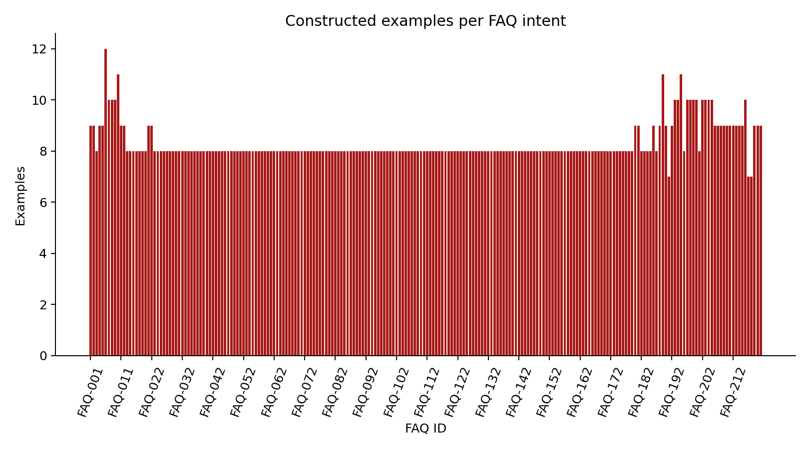
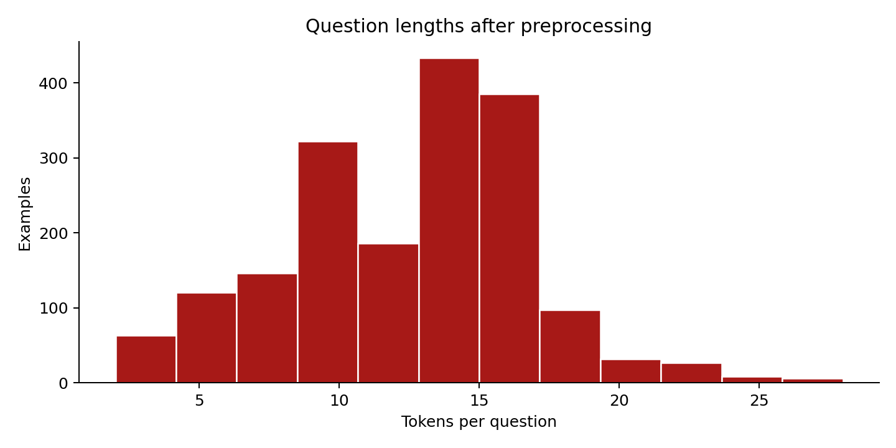
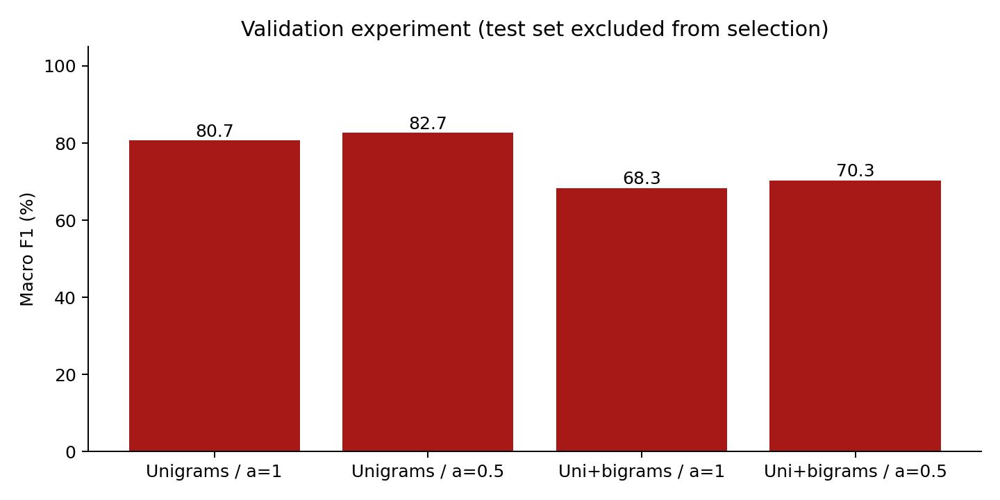
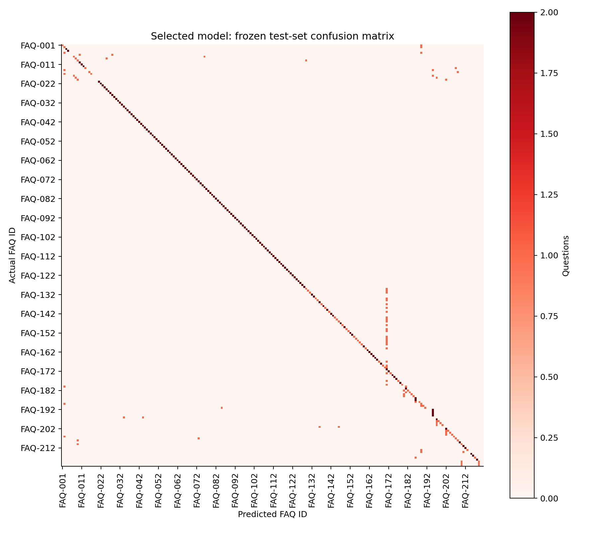
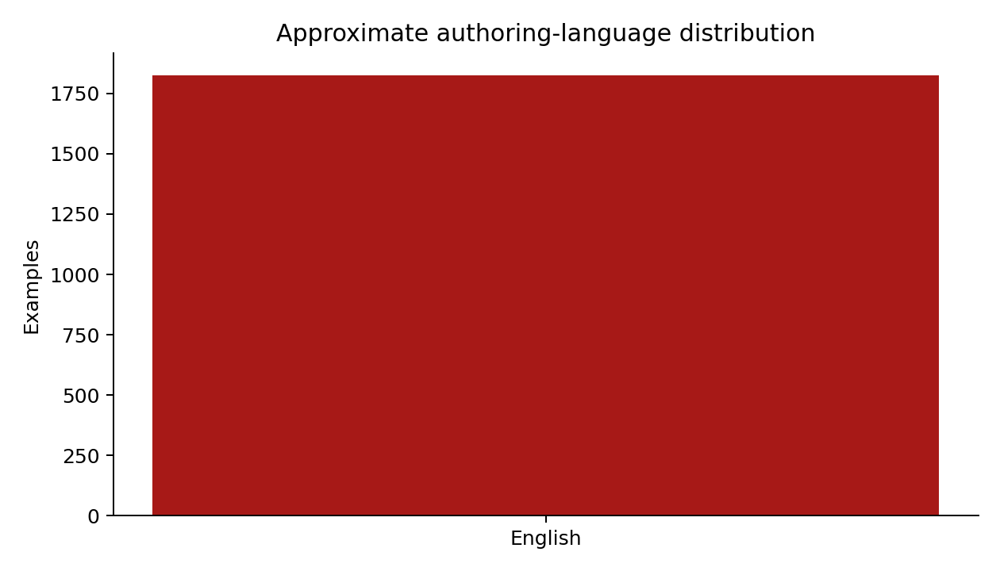
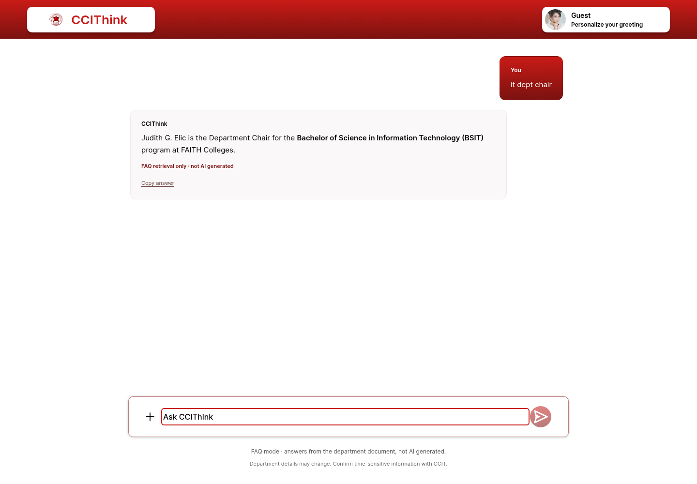
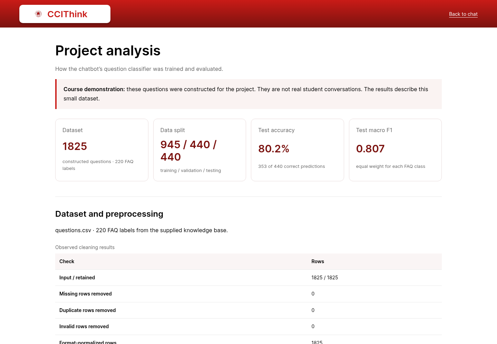

# CCIThink: Development and Evaluation of a Source-Grounded CCIT Chatbot with Naive Bayes FAQ Classification

Five-chapter technical documentation · Draft for author review

Boncajes, Rhian Jared D.

Marcos, Maricar N.

Carandang, Jamie Pearl U.

CCIT, FAITH Colleges

Principles of Artificial Intelligence and Data Science

November 2026 · Draft for author review

<!-- page break -->

## Abstract

This project developed CCIThink, a web-based chatbot that helps students find information about the College of Computing and Information Technology (CCIT) at FAITH Colleges. The chatbot uses a supplied collection of 220 frequently asked questions (FAQs). Its topics include academic programs, scholarships, faculty, curricula, subject prerequisites, student organizations and college events. A question classifier was trained to suggest which FAQ matches a student's question. The dataset contained 1,825 labeled questions: 945 for training, 440 for choosing the model settings, and 440 for testing the selected model. Training questions came from the supplied database. Validation and test questions were written with AI assistance and fixed before the experiment. Four settings of the Naive Bayes classifier were compared. The selected model correctly classified 353 of 440 test questions, giving 80.2% accuracy and a macro F1 score of 0.807. These results apply to the constructed dataset, rather than to actual student use. The chatbot also checks whether the source supports an answer and asks for details when a question is unclear. The project demonstrates a working student information prototype. Evaluation with independently written student questions and confirmation of current department information are recommended before wider use.

Key terms: department chatbot; frequently asked questions; Naive Bayes; text classification; student information

<!-- page break -->

## Chapter 1: Introduction

### Background of the study

Students may need information about their programs, scholarships, subjects, faculty and college activities. Department documents can contain this information, but students must still find the part that answers their question. CCIThink was developed to provide another way of searching the supplied CCIT information through a simple chat interface. This project did not measure existing staff workload or student waiting times. Its purpose was to build and evaluate the chatbot, rather than to claim that it had already improved department services.

The project also applies the topics covered in Principles of Artificial Intelligence and Data Science. These include preparing a dataset, examining its contents, training a model and checking its results (Final project: AI-powered data analysis and prediction system, n.d.). In this study, the model's task is to choose an FAQ label for a question. For example, a question about BSCS internship hours should be linked to the FAQ about that requirement. The model suggests a label; the department information still comes from the stored source answer.

### Problem statement

Students need a way to find a supported answer in the supplied department information. The study asks which of four Naive Bayes configurations best classifies the constructed validation questions, how the selected model performs on the fixed test questions, and which limitations prevent broader claims.

### General and specific objectives

The general objective was to develop a department chatbot with a trainable question classifier. The specific objectives were to prepare labeled examples for the 220 FAQs, check the quality of the dataset, compare four model settings, measure the selected model's performance, and prevent unclear or unsupported questions from receiving an arbitrary answer.

- How accurately does the selected model classify the constructed test questions?
- Which of the four model settings performs best on the validation questions?
- What errors and limitations need to be considered when using the classifier in the chatbot?

### Scope and limitations

CCIThink is limited to the supplied CCIT knowledge. It does not access private student records, calculate grades, complete enrollment transactions or confirm that a policy is still current. The present evaluation uses prepared questions, not a survey or a study involving student participants. It is intended as a final-project prototype that the authors can demonstrate and explain.

### Significance of the project

The project demonstrates a complete Python data-science workflow using department questions. Its value is a working, explainable prototype and a reproducible experiment. It does not establish reduced staff workload, student satisfaction, or deployment effectiveness.

<!-- page break -->

## Chapter 2: Review of Related Systems and Concepts

### AI and Data Science concepts

Naive Bayes is a method for classifying text based on patterns in word counts. It was chosen because its calculations can be implemented and explained in Python without a large pretrained model (Scikit-learn developers, n.d.-b). Accuracy and macro F1 were used to describe its performance (Scikit-learn developers, n.d.-a). These references explain the methods; the project implements its own count-based classifier rather than using scikit-learn to train it.

### Related systems and selected algorithm

Comparison of approaches
| Approach | Role and limitation |
| --- | --- |
| Manual FAQ search | Readers locate an answer themselves; no trained prediction. |
| Naive Bayes text classification | Learns word counts from labeled questions; predicts an FAQ label, not a verified fact (Scikit-learn developers, n.d.-b). |
| Source-grounded chat prototype | CCIThink combines source checks with bounded model ranking and optional provider wording. Successful live generation has not been established. |

### Opportunities for improvement

Related wording, sparse training examples, and overlapping course names make classification difficult. Independently written questions and reviewed labels are needed before claiming reliable real-student performance. This comparison explains design choices rather than inventing a comparative user study.

<!-- page break -->

## Chapter 3: Methodology

### Development approach and data source

The study involved building the software and testing it locally. Each question was treated as one data example. No participants were recruited. The current knowledge base was imported from the user-supplied database_v3.json file, which originally contained 218 FAQs, and extended with three user-supplied department-chair records (CCIT knowledge database, n.d.). The older laboratory overview, FAQ-020, was subsequently removed at the user's request; the separate laboratory overview, FAQ-189, remains active. Other IDs and original answers were retained. Checking the import confirmed that the text was copied correctly; it did not independently verify department policies or staff assignments. Some records have a specific academic year, which must remain clear in answers.

The question dataset contains six columns: an example ID, the question, its correct FAQ label, its assigned split, its language and its origin. Only question text is used as model input. The FAQ label is the expected output. Names of files, answers and other metadata are not used as question features. All 1,825 examples in the current dataset are English.

Table 1. Current dataset allocation
| Purpose | Number of questions | Origin |
| --- | --- | --- |
| Training | 945 | Supplied FAQ titles and alternative questions |
| Validation | 440 | Two AI-authored questions per FAQ |
| Testing | 440 | Two different AI-authored questions per FAQ |
| Total | 1825 | 220 FAQ labels |

The supplied questions provided between three and eight training examples per FAQ. One overlapping question about CCIT Camp was assigned to its specific Camp FAQ instead of the general activities FAQ. The newly written validation and test examples were stored separately before the first experiment. Validation questions were used to choose the model settings. Test questions were reserved for the final measurement and were not changed after the results were inspected. Because the new questions were AI-authored and sometimes use similar sentence patterns, they are not an independent sample of real student questions.

The three department-chair FAQs were supplied as a later update. Their labels and newly authored holdouts extend the original frozen evaluation; all retained holdout questions remain unchanged. The retired FAQ-020 examples are excluded with their label by user request. The revised-corpus experiment is a repeatable constructed-data evaluation, not independent student validation. Texting aliases and conservative typo handling support short questions across topics; unknown codes, missing facts and ambiguous requests still require clarification or fallback.

### Data preparation

The dataset loader checks that required values are present, labels are known, and questions are within the allowed length. It also checks for repeated questions. If the same question has different labels or appears in more than one split, processing stops so the problem can be corrected. Text is converted to a consistent format by standardizing letter case, spaces and common punctuation. Program abbreviations, numbers and words such as “not” are retained because they can affect meaning. The process records unusually long questions but keeps them when they are valid.

### Training and model selection

The model learns how often words occur in questions assigned to each FAQ. It then uses those counts to compare possible labels for a new question. Two input formats were tested: individual words (unigrams), and individual words together with neighboring word pairs (unigrams and bigrams). Each format was tested with smoothing values of 1.0 and 0.5. Smoothing gives a small allowance to word combinations that did not occur during training, instead of treating them as impossible.

Only the training questions were used to learn word patterns. The four settings were compared on the same validation set. The setting with the highest validation macro F1 was selected. The selected model was then evaluated on the test set without being trained again on validation or test examples. A simple comparison method always predicted the most common training label. This comparison shows what can be achieved without using the words in a question.

### Evaluation and chatbot checks

Accuracy is the percentage of test questions assigned to the correct FAQ. Macro F1 summarizes precision and recall while giving equal weight to each FAQ label. Precision concerns whether predictions for a label are correct; recall concerns whether questions belonging to that label are found. Reporting both accuracy and macro F1 helps describe performance across the different topics. A confusion matrix records which labels were mistaken for one another.

Classifier testing is separate from testing the chat application. Before answering, the chatbot checks the question's topic and the details needed to identify a source. For example, “prerequisites” alone should lead to a request for the subject and program. A representative lookup should use the named roster and the requested program or year, rather than a general description of the organization. Short forms such as “reps” and “prereqs” are handled by application rules. Questions that request unavailable details receive a fallback response. The trained model only assists ranking after these checks; a high model score is not proof that an answer is supported.

### Responsible use

The system does not require private student records. Optional AI answer generation sends the question and selected source text to the configured external provider. This service was not used to calculate the classifier results. Department facts and permission to distribute the source should be checked before public use. AI assistance was used in implementation, example writing and drafting this paper. The named authors must review and understand the work before submission.

### Feature selection and Naive Bayes calculation

Question text is converted to counts of words or adjacent word pairs. FAQ IDs, answers, authoring-language tags, and split labels are excluded from input features. The implementation uses log scores to avoid multiplying many small values.

```python
score(label) = log P(label) + sum(count(word) * log P(word | label))
P(word | label) = (training count + alpha) /
                  (all feature counts for label + alpha * vocabulary size)
```

The class prior is its training-question count divided by all training questions. Alpha adds a small smoothing count. Naive Bayes assumes conditional independence of features given the label; that assumption is imperfect for natural language (Scikit-learn developers, n.d.-b).

### System architecture and workflow

- Offline: load CSV, validate and clean rows, describe the data, train four settings, select on validation, evaluate on test, and save the model/report/figures.
- Online: validate a question, detect private requests, resolve a bounded follow-up, check source scope, rank eligible FAQs, and return the source-supported response.
- The local classifier cannot supply missing facts. Unclear requests ask for details; unsupported questions fall back. Optional AI wording uses selected source text only.

<!-- page break -->

## Chapter 4: Results and Discussion

### Dataset checks

All 1,825 input questions passed the dataset checks and were retained. No rows were removed for missing information, invalid values or duplicate questions. The loader standardized the formatting of all rows. Question lengths ranged from 2 to 28 words or number tokens, with an average of 12.33. 9 unusually long questions were retained. Training counts differ across labels because the supplied FAQs contain different numbers of alternative questions. These counts describe the prepared dataset, not the frequency of questions asked by students.





### Validation and test performance

Table 2. Comparison using validation questions only
| Model setting | Correct / total | Accuracy | Macro F1 |
| --- | --- | --- | --- |
| Unigrams / smoothing=1 | 358/440 | 81.4% | 0.807 |
| Unigrams / smoothing=0.5 | 366/440 | 83.2% | 0.827 |
| Uni+bigrams / smoothing=1 | 280/440 | 63.6% | 0.683 |
| Uni+bigrams / smoothing=0.5 | 288/440 | 65.5% | 0.703 |

The individual-word model with smoothing 0.5 performed best on validation, correctly classifying 366 of 440 questions. Its validation macro F1 was 0.827. The word-pair settings did not improve validation performance in this experiment. This result supports the selected setting for this dataset, but does not show that individual words will always work better for other question collections.



On the separate test set, the selected model classified 353 of 440 questions correctly. This gives 80.2% accuracy and a macro F1 of 0.807. The always-predict-one-label comparison achieved 0.5% accuracy. There were 87 incorrect test predictions. The full prediction list and error records are saved with the project.



Errors included confusion between curriculum years, similar prerequisite topics, and broad questions that were assigned to a more specific FAQ. Software tests also checked input handling, source selection, clarification and conversation follow-ups. Browser checks exercised the chat interface on mobile and desktop sizes. These checks help identify software problems; they do not measure student satisfaction or establish the accuracy of every possible conversation.

### Language coverage



The first research question is answered by the test result of 80.2% accuracy. The second is answered by the validation comparison, which favored individual words with smoothing 0.5. The third concerns the mistakes and limits of using this result in a chatbot. Although the model performed better than the simple comparison method, its 87 test errors show that it should not decide answers on its own.

Finding the right FAQ and giving reliable information are related but different tasks. A model can select the wrong FAQ, and even a correctly selected source may contain an outdated policy. The chatbot therefore needs both careful source selection and department review. Clarification rules are especially useful for short questions that omit the subject, program or year. They cannot guarantee that every unclear question will be recognized, so errors should continue to be recorded.

Each FAQ has only two test questions. This is too small to make strong claims about an individual topic. The examples were not independently labeled by students or department staff, and related wording may remain across the splits. All current examples are English, so the results do not establish performance on Filipino or Taglish. The project also did not measure response-time improvements, staff workload, student satisfaction or use under real deployment conditions.

The next step should be to collect independently written student questions with appropriate permission, ask reviewers to check their labels, and prepare a new test set. More examples should cover difficult curriculum distinctions, abbreviated wording, typos and questions outside the database. New evaluation questions are needed before making a fresh accuracy claim after further training changes. Department representatives should also confirm the dates and contents of the stored information.

<!-- page break -->

## Chapter 5: Conclusion and Recommendations

CCIThink demonstrates how a department chatbot can combine a stored FAQ collection, a trainable question classifier and rules for handling unclear requests. The current model covers 220 FAQ labels and achieved 80.2% accuracy on 440 constructed test questions. The project provides a working final-project prototype and a repeatable way to examine its results. Its findings support further development, rather than a claim that it is already reliable for all student questions. Independent student evaluation and updated department verification remain necessary.

### Achievement of objectives and recommendations

The system loads and validates data, describes patterns with five charts, implements and compares an explained classifier, evaluates fixed test questions, and demonstrates supported chat and predictions. The objective is a course prototype, not proof of unrestricted reliability.

Each FAQ has only two test questions. This is too small to make strong claims about an individual topic. The examples were not independently labeled by students or department staff, and related wording may remain across the splits. All current examples are English, so the results do not establish performance on Filipino or Taglish. The project also did not measure response-time improvements, staff workload, student satisfaction or use under real deployment conditions.

The next step should be to collect independently written student questions with appropriate permission, ask reviewers to check their labels, and prepare a new test set. More examples should cover difficult curriculum distinctions, abbreviated wording, typos and questions outside the database. New evaluation questions are needed before making a fresh accuracy claim after further training changes. Department representatives should also confirm the dates and contents of the stored information.

<!-- page break -->

## References

CCIT knowledge database. (n.d.). *database_v3.json and department-chair update* [User-supplied source collection; currency and broader usage permission unconfirmed].

Final project: AI-powered data analysis and prediction system. (n.d.). *Final project documentation guidelines* [Course handout; original PDF retained as docs/FINAL_PROJECT.pdf].

Scikit-learn developers. (n.d.-a). *Metrics and scoring: Quantifying the quality of predictions*. https://scikit-learn.org/stable/modules/model_evaluation.html

Scikit-learn developers. (n.d.-b). *Naive Bayes*. https://scikit-learn.org/stable/modules/naive_bayes.html

## Appendices

### A. Source code, dataset, and usage

Repository: https://github.com/jared-boncajes/CCIT_Chatbot. The data dictionary is data/README.md. data/knowledge.json contains the supported source answers; data/questions.csv contains labeled classification questions. Institutional currency and wider redistribution permissions remain unconfirmed.

Permitted project sample: constructed questions, not student transcripts
| Sample | Question | Target |
| --- | --- | --- |
| FAQ-011-V3-TRAIN-01 | Are scholarships available based on senior high school performance? | FAQ-011 |
| FAQ-010-V3-TRAIN-01 | Are the BSIT, BSCS, and BSEMC programs accredited? | FAQ-010 |
| FAQ-011-V3-TRAIN-02 | Are there additional scholarship opportunities for CCIT students? | FAQ-011 |

### B. Demonstration screenshots





### C. Test cases and additional results

The tests directory includes canonical/alternative question checks, shorthand, unclear scope, source support, privacy, provider failures, CSV validation, model arithmetic, leakage checks, and repeatable training. docs/testing.md records the latest executed validation. research/results/test_predictions.csv retains every classifier test prediction; report.json contains per-class scores and errors.

### D. User guide and responsible AI disclosure

See README.md for installation and docs/beginner-guide.md for the code-reading guide and worked Bayes example. AI assistance was used for implementation, constructed questions, debugging, and drafting. Named authors must review the work and be able to explain the code. No interviews, survey results, or real-user outcomes are claimed.

```python
python -m pip install -r requirements-research.txt
python tools/build_dataset.py
python analyze.py
python -m pytest -q
# Start a separate terminal with CHAT_MODE=faq, then: python app.py
python tools/build_project_documents.py
```
